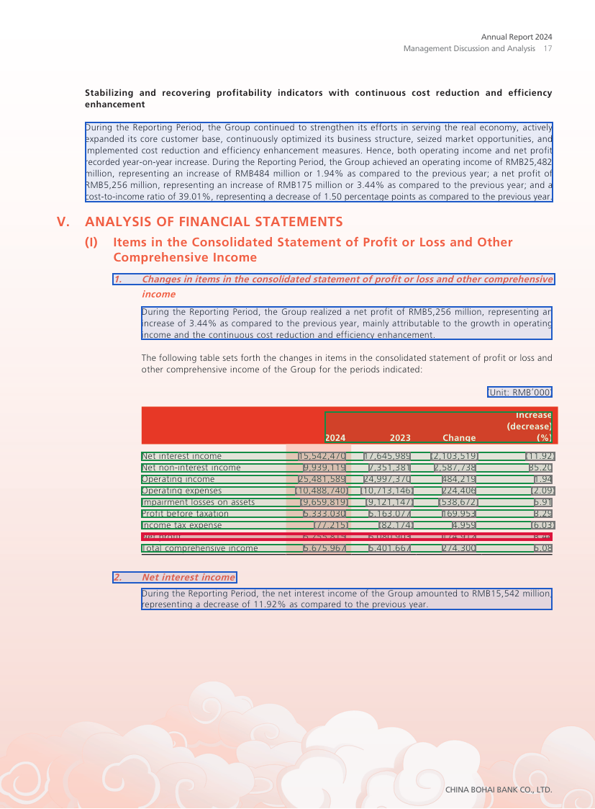

# Citation-first retrieval over financial documents

Ask a question about a 277-page annual report and get an answer in prose that
cites the page, the box and the exact quote it came from. If a number in the
answer cannot be found in a quote it cites, **the answer is withheld**.



## Demo

**Command line, two minutes** (needs `DEEPSEEK_API_KEY`):

```bash
export DEEPSEEK_API_KEY=sk-...
./scripts/demo.sh
```

It prints the corpus size, answers one question with its citations, then asks the
same question with the evidence removed — and shows what the system does when the
quote cannot support the answer.

**In the browser**, the bench turns each page into clickable evidence.

1. **Upload** an annual report and parse a page range (about 5 s/page, cached).
2. **Click any box** on the page — the right panel shows that unit's crop, its
   quote and its numbers, with *Accept as evidence* / *Delete*.
3. **Ask** in the fourth tab. You get the answer, a verdict, the cited units as
   cropped images, and the tool calls the model made. If a number is not in the
   cited quotes, the panel turns amber and the answer is not shown.

The crop beside every citation is taken from the PDF at that unit's box:


**Slides:** [docs/presentation.html](docs/presentation.html) — eight screens,
arrow keys to move, no server needed.

## Quickstart

```bash
python3 -m venv .venv && source .venv/bin/activate      # Python 3.11+
pip install -r requirements.txt

# 1. put a text-layer annual report in samples/ (they are not redistributed)
# 2. parse it into units — one page ≈ 5 s, cached per page
python scripts/build_unit_corpus.py --pdf samples/my_report.pdf \
    --out annotations/corpus/units.jsonl

# 3. open the bench
streamlit run app.py
```

Asking needs a DeepSeek API key, entered in the sidebar (session only). Parsing,
retrieval and the annotation bench run offline.

## How it works

```
PDF
 │
 ├─ Docling ─────► layout regions, table structures
 └─ PyMuPDF ─────► text layer, word boxes, page renders
        │
        ▼
     UNITS   (doc, page, bbox, quote, value)
        │      text = paragraphs, table = rows, figures = captions
        ▼
   RETRIEVAL   BM25 + bge-small embeddings → RRF fusion → cross-encoder rerank
        │      query expansion rewrites the question into report vocabulary
        ▼
     AGENT     a hand-written JSON tool loop (no framework)
        │      tools: search_expanded, search_bm25, search_semantic,
        │             find_row, read_table, read_unit
        ▼
  VERIFICATION every number in the answer must appear in a cited quote;
        │      a cited row must hold it in the asked-for year's column;
        │      Group questions may not be answered from notes or segments
        ▼
    ANSWER or REFUSAL (with the failed check, logged)
```

Each step exists because of a measured failure:

| step | why it is there |
|---|---|
| units, not chunks | a citation must be a page region you can crop and show |
| row-level table units | a whole-table citation cannot tell "net profit" from "operating income" |
| header and section on each unit | the same label appears on the primary statement and in the notes |
| expansion + rerank | paraphrases score 0.20 without them, 0.80 with |
| verification | without it, the model writes numbers no quote contains |

## What each part does

| module | role |
|---|---|
| `finrag/ingest.py` | PDF → units; Docling for structure, PyMuPDF for text boxes; per-page cache |
| `finrag/overlay.py` | draws unit boxes on a page render, highlights the selected one |
| `finrag/ui.py` | crops a unit's region, formats answers |
| `finrag/retrieve.py` | BM25 with CJK bigrams, RRF fusion |
| `finrag/vectors.py` | `bge-small-en-v1.5` index, saved as `.npz` + manifest |
| `finrag/sections.py` | attaches the nearest page heading to every unit |
| `finrag/tables.py` | groups rows into the table they came from |
| `finrag/agent_rag.py` | tools, the tool loop, and verification |
| `finrag/llm.py` | DeepSeek client and an offline stub |
| `finrag/annotations.py` | accepted evidence, questions, reset |
| `finrag/real_eval.py`, `metrics.py` | scoring, Wilson intervals, McNemar |
| `finrag/select.py` | select-then-extract experiment (measured, not used) |

| script | role |
|---|---|
| `scripts/build_unit_corpus.py` | parse a PDF to `units.jsonl` |
| `scripts/score_agent.py` | run a question set through the agent |
| `scripts/restriction_eval.py` | evidence withheld — the permission experiment |
| `scripts/enforcement_eval.py` | what verification catches, with it on and off |
| `scripts/retrieval_refine.py` | the four retrieval arms |
| `scripts/reproduce.sh` | rebuild every table in `RESULTS.md` |

## Results

[RESULTS.md](RESULTS.md) is the single source of truth. Frozen configuration,
three runs per set:

| question set | correct | wrong |
|---|---|---|
| uses the report's own wording (31) | **0.94** | 0–1 |
| concept questions, written before mapping (14) | **0.86** | 0–1 |
| fair paraphrases (19) | **0.67** | 4–6 |
| multi-hop ratios (5) | **1.00** | 0 |

Against a chunk-RAG baseline with no checks: equal on easy questions (12/14),
better on paraphrases (12.7 vs 9), and with the evidence removed it answers
wrongly 2 times where the baseline does so 7 ([BASELINE_CHUNK.md](BASELINE_CHUNK.md)).
With verification switched off on the agent itself, the checks almost never fire
on ordinary questions (0 unsupported), so their value is concentrated in the
insufficient-evidence case ([BASELINE_NO_CHECK.md](BASELINE_NO_CHECK.md)).
An LLM judge agrees with the deterministic scorer 0.93–0.95 (kappa 0.81–0.87) and
finds every answer faithful to its citations ([JUDGE.md](JUDGE.md)).
| second English filing (BOC HK, 10) | **0.60** | 4 |
| Chinese filing, 15 questions | **0.47** (7/15) | 4 |
| chart questions, answered from images (5) | **0.40** (2/5) | 1 |
| same, with `deepseek-reasoner` | **0.76** | 2 |
| evidence withheld (14) | 0 correct, 2 lookalike answers, 12 refusals | — |

## The finding

Verification proves a number exists in a quote. It cannot prove the quote answers
the question:

| | enforcement off | enforcement on |
|---|---|---|
| invented a number in no quote | 4 | **0 shown** |
| real number from the wrong row, year or entity | 4 | **4 still shown** |

[ENFORCEMENT.md](ENFORCEMENT.md), [RESTRICTION.md](RESTRICTION.md).

## Limitations

- **One English document.** A second (Chinese) filing parses into 10,052 units and
  retrieves at 0.73 once its header context is indexed and `bge-m3` is used, but
  the agent answers only 7 of 15 ([TENCENT.md](TENCENT.md)).
- **Two English filings** (Bohai, BOC HK) and one Chinese; the second is small
  (10 questions, machine-mapped) and lands at 0.60.
- **60 questions, written by the author.** Three of the ten paraphrases are
  ambiguous; [AUDIT.md](AUDIT.md) lists them and reports both scores.
- **Charts are not read.** Figure units carry captions only; "multimodal" here
  means tables.
- **Permissions are simulated** by removing evidence, not enforced by an access
  model.
- **The graph is a linker, not a reasoner.** Promoting twins into retrieval made
  answers worse (11/9 vs 12.7), so it is used for lookup and multi-hop only.
- **Negative results are documented** rather than hidden: table-level context
  (0.54), select-then-extract (0.16–0.36), label-similarity checks (unusable),
  graph promotion (worse) —
  see [TABLE_CONTEXT.md](TABLE_CONTEXT.md), [SELECT_EXTRACT.md](SELECT_EXTRACT.md).

## Reproduce

```bash
export DEEPSEEK_API_KEY=...
bash scripts/reproduce.sh        # corpus, 3 runs per set, restriction, tests
```

## Tests

```bash
python -m pytest -q              # 60 passed, no network
```

## Layout

```
app.py            annotation bench and Ask tab
finrag/           ingest, retrieval, vectors, agent, verification, metrics
scripts/          corpus build, evaluations, restriction, smoke test
tests/            60 tests
docs/             specs: project, agent, retrieval, accuracy, evidence
*.md              results and audits — start with RESULTS.md
annotations/      question sets and accepted units (generated data gitignored)
```

Earlier synthetic-corpus experiments from the previous topic remain in
`finrag/` and `scripts/` for provenance; they are not part of the pipeline above.
